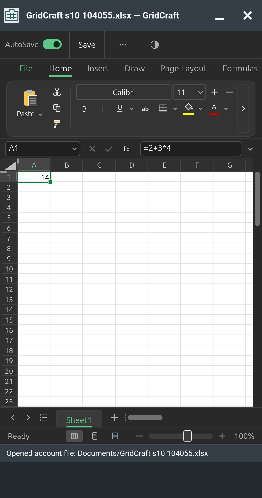

# GridCraft on the Galaxy S10+

GridCraft source `446a7df6c2b6` and viewer `227df9c7785b`. The WebOS wrapper uses the retained native Rust/WASM workbook engine. The build recipe is in [the WebOS integration README](../../webos/README.md). To package the viewer, use its `--gridcraft-site` option with a verified GridCraft native site. This release leaves the native engine bytes in place and rebuilds the document wrapper and stylesheet.

1. In a disposable signed-in session, open **Apps → Office → GridCraft**.
2. Select A1, tap the formula bar, type `=2+3*4` and commit with its checkmark. A1 displays `14`.
3. Tap **Save**. In Save As, type a name without its extension. The app saves an editable `.xlsx` and displays the account path.
4. Close GridCraft. Open **Files → Documents**, select the workbook and choose **Open**. GridCraft shows the same value and editable formula.

The physical Galaxy S10+ used Chrome 158.0.8127.92 at 411 CSS pixels and 480 pixels of height with the software keyboard shown. Chromium 158.0.8127.36 passed the equivalent file cycle at 820 and 1300 CSS pixels. The workbook archive at all three widths contained the A1 formula and cached value `14`. On the phone, the status bar used the space directly below the editor and showed the saved or opened path on a dark surface. The WebOS adapter suite passed all 27 checks.

This workflow covers four of ten baseline tasks. It covers launch, formula entry, editable save and reopen via Files. The remaining tasks are device import, export to another supported format, second save or Save As to an existing workbook, undo and recovery, multi-sheet and formatting work, and print. A desktop run also briefly showed the earlier recovery message alongside the confirmed account save. The account workbook opened with its saved content. These items stay in desktop qualification.

